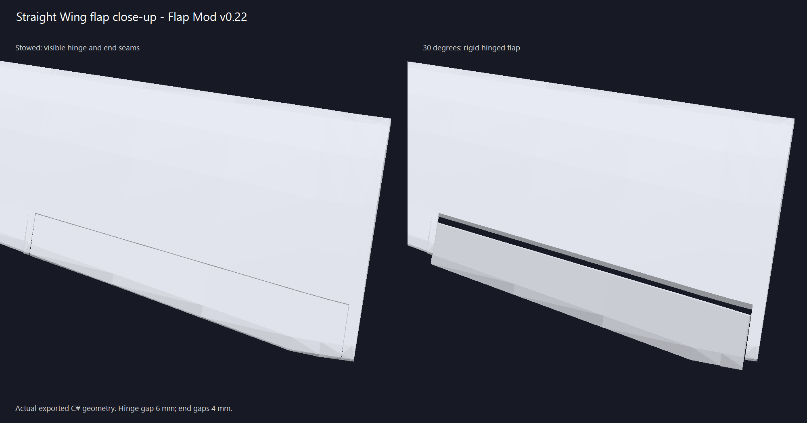

# Flap Mod

One plugin contains Big Wing flaps and the Straight Wing hinged flap candidate. Big Wing v0.20 geometry is preserved in the combined v0.22 build.

**v0.22 flight retesting is pending.** This update corrects the added force application associated with the reported v0.21 pitch-up and speed loss. The combined DLL compiles and passes geometry and force regression checks; a static render was inspected, but the updated build has not been flight-tested in-game.

## What changed in v0.22

- Straight Wing has a visible 6 mm hinge seam and 4 mm end seams, with both mesh bodies closed. Native ailerons are unchanged.
- Straight Wing added forces follow the animated flap angle and the measured flap area (about 22.6% of the stock planform).
- Added lift uses the game's balanced lift origin; drag acts through the rigidbody centre of mass and uses the native drag coefficient.
- Shared limits cap total added Straight Wing lift at 0.25 g and drag at 0.04 g across the active aircraft's wings. The stock wing forces are unchanged.
- The combined plugin display name is now **Flap Mod**. The DLL filename and plugin ID stay the same for replacement installs.

## Downloads

- **[Download AviassemblyFlaps.dll](https://github.com/HotBowl1080/Aviassembly-Mods/raw/refs/heads/main/Flaps/AviassemblyFlaps.dll)** — the combined game plugin.
- [Download the wing viewer ZIP](https://github.com/HotBowl1080/Aviassembly-Mods/raw/refs/heads/main/Flaps/aviassembly-wing-preview.zip) — optional browser preview with all 16 native wing parts.
- [Older viewer versions](archive/) — archived previews for reference.

The current DLL checksum is recorded in [SHA256.txt](SHA256.txt).

## Install

1. Close Aviassembly. BepInEx 5 must already be installed and initialized.
2. Back up your installed `AviassemblyFlaps.dll`.
3. Copy the downloaded DLL into `Aviassembly/BepInEx/plugins/`, replacing the existing copy. Keep only one copy installed.
4. Restart the game and enable flaps on each supported wing. Enablement must currently be selected again after loading an aircraft.

## Wing support

| Wing | Flaps | Preview |
| --- | --- | --- |
| Big Wing | v0.20 behavior retained in the combined DLL | Modified model and animation |
| Straight Wing | v0.22 candidate; in-game testing pending | Actual cut mesh and C# poses, 0–30 degrees |
| Other 14 native wing parts | Stock controls retained | Native meshes with child transforms baked in |

## Controls

Use the shared lever or `[` / `]` to select 0, 10, 20 or 30 degrees.

| Setting | Main flap angle | Big Wing slats | Big Wing leading-edge flaps |
| --- | --- | --- | --- |
| 1 | 0 degrees | Retracted | Retracted |
| 2 | 10 degrees | Retracted | Retracted |
| 3 | 20 degrees | Extended | Retracted |
| 4 | 30 degrees | Extended | Extended |

On Big Wing, hold Control at idle or reverse for spoilers and ground braking. The winglet and native aileron remain separate from flap motion.

Straight Wing uses one rigid inboard trailing-edge flap and retains its native aileron. Between 20 and 30 degrees, the last setting smoothly adds 25.4 mm aft and 12.7 mm down travel.

## Wing viewer

Extract the viewer ZIP, then open `aviassembly-wing-preview.html` in Chrome or Edge. Internet access is needed for the rendering library; all model data is embedded in the HTML.

Choose a wing from the dropdown, drag to rotate, scroll to zoom, and choose Whole wing or an available device view. Native ailerons are shown at neutral. Modified wings use their generated mod geometry and animation.

## Development

| Path | Purpose |
| --- | --- |
| [src](src/) | Plugin source |
| [build.ps1](build.ps1) | Build against installed game, Unity, BepInEx and Harmony assemblies |
| [tests](tests/) | Geometry runner and recorded validation results |
| [tools](tools/) | Native wing capture and embedded viewer updates |
| [STRAIGHT-WING-DEVELOPMENT.md](STRAIGHT-WING-DEVELOPMENT.md) | Straight Wing checks and remaining in-game test steps |
| [MODEL-UPDATES.md](MODEL-UPDATES.md) | Shared viewer export and update workflow |
| [Big Wing v0.20 notes](docs/BIG-WING-v0.20.md) | Preserved geometry and validation history |
| [archive](archive/) | Older viewer ZIPs |

Build from this folder with `./build.ps1 -GameDir '<Aviassembly installation>'`. Publish matching source, compiled DLL and modified previews together. Finish Straight Wing in-game verification before implementing another wing.
